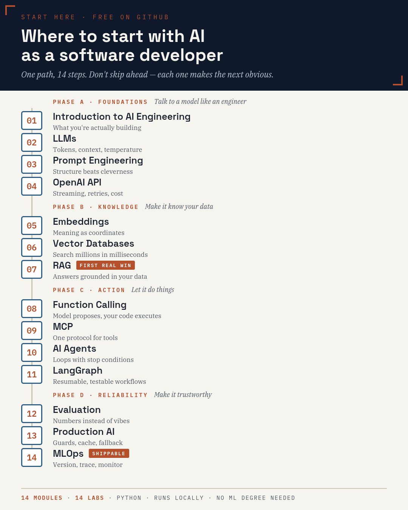

# AI Engineering, Assembled in Order

**A free course for software developers who don't know where to start with AI.**
14 short modules in build order, a hands-on lab after each one, and working code, all growing one project:
a RAG bot that cites its sources, refuses when it doesn't know, and has evals, tracing, and a rollback plan.



[](../../actions/workflows/ci.yml)

**Start here:** read [`docs/AI-Engineering-Course.pdf`](docs/AI-Engineering-Course.pdf) (31 pages), then do the lab at the end of each module using the code in `labs/`.
No ML background needed. If you can read Python, you're qualified.

## Why the order matters

Most AI content teaches topics at random. This stack is cumulative:

`LLMs → prompts → API → embeddings → vector DB → RAG → function calling → MCP → agents → LangGraph → evals → production → MLOps`

Embeddings feed the vector DB, the vector DB feeds RAG, RAG gets tools, tools become agents, agents get evaluated, evaluated systems get hardened.
Skip a layer and the next one stops making sense.

## Quick start

```bash
git clone <this-repo> && cd ai-engineering-labs
python -m venv .venv && source .venv/bin/activate      # Windows: .venv\Scripts\activate
pip install -r requirements.txt
cp .env.example .env                                    # add OPENAI_API_KEY and set CHAT_MODEL
python labs/04-openai-api/chat_cli.py                   # first call: streaming chat with a cost ledger
```

Every script runs from any directory. Developed and tested on Python 3.12.

> **Set `CHAT_MODEL` to a current model.** Providers retire models over time, so nothing is hardcoded:
> pick a current chat model from your provider's models page and put it in `.env`.
> Optionally set `PRICE_IN_PER_M` / `PRICE_OUT_PER_M` from the pricing page so the cost ledger shows real dollars.
> The labs make small API calls; `cost_ledger.csv` shows exactly what you've spent.

> **Optional — run it on Claude.** `common/llm_anthropic.py` is a standalone Claude + Voyage
> port of the Lab-04 wrapper (`pip install -r requirements-anthropic.txt`; set `ANTHROPIC_API_KEY`
> and `VOYAGE_API_KEY`). It's a reference implementation — the NOTES at the bottom of that file
> explain what wiring it into every lab would take.

## The labs

| # | Module | You build | Run |
|---|--------|-----------|-----|
| 01 | Intro | Project spec (no code) | [`PROJECT_SPEC_TEMPLATE.md`](labs/01-intro/PROJECT_SPEC_TEMPLATE.md) |
| 02 | LLMs | Token counts, temperature sweep, context stress test | `labs/02-llms/*.py` |
| 03 | Prompt engineering | Versioned prompts + 5-case mini-eval | `labs/03-prompt-engineering/mini_eval.py` |
| 04 | OpenAI API | The `ask()` wrapper: streaming, retries, cost ledger ([`common/llm.py`](common/llm.py)) | `labs/04-openai-api/chat_cli.py` |
| 05 | Embeddings | Semantic grep over a folder | `labs/05-embeddings/semantic_grep.py "query" ./docs` |
| 06 | Vector DB | Chroma index + idempotent reindex | `labs/06-vector-db/reindex.py` |
| 07 | RAG | Citations + honest refusals | `labs/07-rag/rag.py` |
| 08 | Function calling | Validated tools, human-gated refunds | `labs/08-function-calling/support_bot.py` |
| 09 | MCP | Minimal MCP server | `labs/09-mcp/server.py` |
| 10 | Agents | Bounded loop: iteration, token, time caps | `labs/10-agents/agent.py` |
| 11 | LangGraph | Resumable graph, pause-for-approval | `labs/11-langgraph/graph_agent.py` |
| 12 | Evaluation | Dataset, scorers, LLM judge, regression gate | `labs/12-evaluation/run_eval.py` |
| 13 | Production | Cache, fallback, input/output guards | `labs/13-production/hardened.py` |
| 14 | MLOps | Version tuple, tracing, replay | `labs/14-mlops/trace.py` |

**How to use them:** each lab page in the PDF lists the exercises. The code in `labs/` is a reference implementation of that lab's
"Ship It" challenge. Try the exercise yourself first, then compare.

**Order dependencies:** Labs 07, 11, 12, 13 and 14 need the Lab 06 index first: `python labs/06-vector-db/reindex.py`.
Labs 04 → 14 all import the wrapper from `common/llm.py`.

## Tests

```bash
pip install -r requirements-dev.txt
pytest -q
```

The suite runs fully offline against a fake OpenAI client: it builds a real Chroma index, runs a real LangGraph graph,
and checks the safety-critical paths (sandbox escapes, refund gate, bounded loops, citation verification, regression gate).
What it can't check is live model behaviour, so run the labs once with your own key.

## Troubleshooting

| Symptom | Fix |
|---|---|
| `model not found` / deprecation error | Set `CHAT_MODEL` in `.env` to a current model |
| 400 error mentioning `temperature` | Handled automatically: `ask()` retries without it. Some newer models reject custom temperature |
| `No index found` | Run `python labs/06-vector-db/reindex.py` first |
| `mcp` import errors | `server.py` supports mcp 1.x and 2.x. Run `pip install -U mcp` |

## Contributing

Found a bug, a stale model name, or a confusing explanation? Open an issue or PR, those are the most useful contributions.

## License

Code: MIT ([`LICENSE`](LICENSE)). Course PDF and images: CC BY-NC 4.0 ([`docs/LICENSE.md`](docs/LICENSE.md)).
